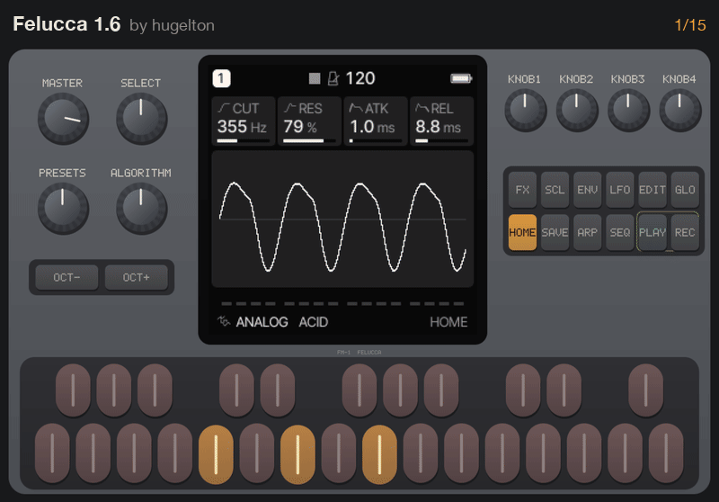

# FM-1 emulator

The **M-VAVE FM-1** is a pocket FM synthesizer, and a small community writes its own firmwares
for it: drum machines, grooveboxes, ambient generators, a chord harp. This project emulates the
FM-1 itself, its CPU, screen, keys, knobs and audio, so every one of those firmwares runs
unchanged in a browser or on a computer. You can try a firmware before you install it, write
one without a synth on the desk, or just play.

**Play it: [joakimeriksson.github.io/fm1-emu](https://joakimeriksson.github.io/fm1-emu/)**:
pick a firmware, press Start, play with the computer keyboard, the mouse, a touch screen or
a MIDI keyboard.

[](https://joakimeriksson.github.io/fm1-emu/)

The page hosts no firmware: it downloads each one from its author's own site when you start
it, the same update package you would install on a real FM-1. M-VAVE's own firmware can't be
fetched that way, so download `FM-1.fwsc` from M-VAVE and open it on the page.

Also here: **[FM-1 SID](fm1-sid/)**, a firmware that turns the FM-1 into a Commodore 64 SID
synth, with a step sequencer and stereo chorus, delay and reverb, that also plays C64 tunes
([its page](https://joakimeriksson.github.io/fm1-emu/fm1-sid/) plays all of HVSC).

## What runs

The 20 community firmwares listed on [fm1-editor.com/firmware](https://fm1-editor.com/firmware/)
whose packages are published, FM-1 SID, and M-VAVE's stock firmware (V13 and V15) with both
CPU cores running. Each name below opens the page with that firmware picked; press Start.

<!-- firmwares: node tools/readme_firmwares.mjs -->
| Firmware (opens it on the page) | By | What it is |
|---|---|---|
| [M-VAVE stock firmware](https://joakimeriksson.github.io/fm1-emu/?fw=mvave) | [M-VAVE](https://github.com/joakimeriksson/fm1-emu/blob/master/docs/stock-firmware.md) | The firmware the FM-1 ships with: a DX7-style FM synth, both cores running. Bring your own `FM-1.fwsc`. |
| [Felucca 1.6](https://joakimeriksson.github.io/fm1-emu/?fw=felucca) | [hugelton](https://github.com/hugelton/Felucca) | The original open firmware: a four-operator FM synth with sequencer, arpeggiator and effects. |
| [Felucca [Salt] 0.9-salt14](https://joakimeriksson.github.io/fm1-emu/?fw=felucca-salt) | [ChanceTheMaker](https://github.com/ChanceTheMaker/Felucca) | A Felucca fork with its own sound and editor changes. |
| [AMB-1 1.1](https://joakimeriksson.github.io/fm1-emu/?fw=amb) | [charlesvestal](https://github.com/charlesvestal/fm1-amb) | A generative ambient machine inspired by Music for Airports. |
| [April OS BETA 1.1](https://joakimeriksson.github.io/fm1-emu/?fw=april) | [beashoko](https://github.com/beashoko/april-os) | A sampler inspired by the Casio SK-1: no synth engines, only samples, recorded through the installer page's microphone bridge. |
| [ChoralRoot 0.21](https://joakimeriksson.github.io/fm1-emu/?fw=choralroot) | [Quixotic7](https://github.com/Quixotic7/ChoralRootFM1) | A port of the Choral Root synth. |
| [FiMba-1 0.6.1](https://joakimeriksson.github.io/fm1-emu/?fw=fimba) | [jadamsowers](https://github.com/jadamsowers/fm1-fimba) | A physically modelled kalimba (thumb piano), with mbira patterns, tape and grains. |
| [FoMni 0.3.2](https://joakimeriksson.github.io/fm1-emu/?fw=fomni) | [charlesvestal](https://github.com/charlesvestal/fm1-fomni) | A chord harp inspired by the Omnichord: hold a chord, strum the keys. |
| [FuMi-1 1.0.7](https://joakimeriksson.github.io/fm1-emu/?fw=fumi) | [cartesive](https://github.com/cartesive/fumi-1) | Inspired by the Suiko ST-50 shigin conductor: koto and shakuhachi-style tones. |
| [GHOULBOX 2.1](https://joakimeriksson.github.io/fm1-emu/?fw=ghoulbox) | [jasonpersinger](https://github.com/jasonpersinger/ghoulbox-fm1-dungeon-synth) | Dungeon synth (a Felucca fork): cathedral reverb and dark drones. |
| [Hortator 0.16.0](https://joakimeriksson.github.io/fm1-emu/?fw=hortator) | [DeadActive](https://github.com/DeadActive/hortator) | A drum-focused firmware based on Felucca. |
| [Jangada 0.9.9](https://joakimeriksson.github.io/fm1-emu/?fw=jangada) | [zednaked](https://github.com/zednaked/jangada) | Superwave analog voices and a modulation matrix. |
| [Melodee 1.3.3](https://joakimeriksson.github.io/fm1-emu/?fw=melodee) | [keremimo](https://github.com/keremimo/melodee) | A melodic synth firmware (a Felucca fork) with dual-core audio. |
| [ORBIT 0.7.0](https://joakimeriksson.github.io/fm1-emu/?fw=orbit) | [dspaudio](https://github.com/dspaudio/orbit) | A four-track groovebox based on SLOOP: three synth parts and a drum machine, an event tape to rearrange them, OP-1-inspired screens. |
| [PurpleMonkey 0.11](https://joakimeriksson.github.io/fm1-emu/?fw=purplemonkey) | [Quixotic7](https://github.com/Quixotic7/PurpleMonkeyFM1) | A firmware for kids. |
| [FM1 Quest 0.21](https://joakimeriksson.github.io/fm1-emu/?fw=quest) | [hericdk](https://github.com/hericdk/fm1-quest) | A live RPG adventure inside the synth. |
| [Rainbow mode 1.1.5-rb](https://joakimeriksson.github.io/fm1-emu/?fw=rainbow) | [joshbartlettband-web](https://github.com/joshbartlettband-web/felucca-rainbow) | A music toy for little hands (a Felucca fork). |
| [FM-1 SID 0.1](https://joakimeriksson.github.io/fm1-emu/?fw=sid) | [joakimeriksson](https://github.com/joakimeriksson/fm1-emu/tree/master/fm1-sid) | A SID chip on the FM-1, as a synth: the keys play 12 instruments, KNOB1-4 are cutoff, resonance, attack, release; FX opens chorus, delay and reverb. |
| [SLOOP 2.6](https://joakimeriksson.github.io/fm1-emu/?fw=sloop) | [isod89](https://github.com/isod89/sloop-fm1) | A live groovebox: four looping tracks. |
| [SLOOP ALG ALG05-TEST](https://joakimeriksson.github.io/fm1-emu/?fw=sloop-alg) | [shaw-core](https://github.com/shaw-core/Sloop_ALG02) | A SLOOP test build with extra FM algorithms. |
| [WaveLoop Kit 1.0.5.2-midi23](https://joakimeriksson.github.io/fm1-emu/?fw=waveloop) | [ELI7VH](https://github.com/ELI7VH/Felucca) | A Felucca mod: standalone Arturia MiniLab 3 control, fine track mixing, a DJ filter, momentary effects and MIDI feedback. |
| [X0X 1.0.6](https://joakimeriksson.github.io/fm1-emu/?fw=x0x) | [charlesvestal](https://github.com/charlesvestal/fm1-x0x) | A groovebox: 909, 808, two 303s and a break player. |
<!-- /firmwares -->

MIDI in works through the emulated MIDI IN jack, so each firmware reads MIDI with its own
driver: Web MIDI on the page (Chrome, Edge, Firefox), any MIDI input natively. M-VAVE's
firmware listens on channel 2 in the emulator (not yet checked on a real FM-1); Felucca plays
its parts on channels 1–4.

## On your computer

```sh
cargo run --release -p fm1-live -- --fw list           # the firmwares
node tools/fetch_firmwares.mjs                          # download them into reference/firmwares
cargo run --release -p fm1-live -- --fw felucca         # a window with the synth, audio out
cargo run --release -p fm1-live -- --fwsc FM-1.fwsc     # M-VAVE's own, from its package
```

`fm1-live` runs the real 240 MHz clock on Apple silicon Macs, with an AArch64 JIT; elsewhere
it interprets (`--mhz` lowers the clock if that can't keep up). It plays every MIDI input of the computer (`--midi NAME`, `--midi none`,
`--midi-ch N`) and loads a DX7 bank into M-VAVE's firmware with `--syx bank.syx`.
`fm1-emu` is the batch runner for tests and debugging (WAV and screen output, breakpoints,
memory dumps).

The page builds with `web/build.sh` (Rust to WebAssembly; needs the `wasm32-unknown-unknown`
target), the whole site with `tools/build_site.sh`.

## How it works

The FM-1 is built on a JieLi AC791N: two cores of JieLi's own 32-bit pi32v2 CPU, with no
public instruction set manual. The instruction set here was recovered from the firmwares
themselves (`isa/`, `docs/isa-notes.md`) and checked against test programs built with JieLi's
toolchain. On top of the CPU sit models of the chip's timers, interrupts, flash, the
240×240 screen, the key matrix and encoders, the knobs, the audio output and the MIDI UART.
Hot code is compiled, to AArch64 natively and to WebAssembly in the browser.
How it was built and checked, step by step, is told in a technical report:
[Emulating a Synthesizer Before It Arrives](https://joakimeriksson.github.io/fm1-emu/fm1-emu-report.pdf)
(PDF, 8 pages).

- `crates/`: `fm1-isa` (decoder tables), `fm1-core` (CPU and JITs), `fm1-soc` (the chip and
  the board), `fm1-live` (the native synth), `fm1-emu` (batch runner), `fm1-web` (the wasm
  build), `fm1-gdbstub`
- `web/`: the page; `web/fwsc.js` unpacks the update packages
- `docs/`: the hardware notes (`recon.md`), the instruction set (`isa-notes.md`), M-VAVE's
  firmware (`stock-firmware.md`); `PLAN.md` is the work log
- `tools/`, `probes/`: ISA extraction, benchmarks, differential test programs
- `fm1-sid/`: the SID study and player firmware (its own README)

## Licences

The emulator is MIT (`LICENSE`). The firmwares are their authors' and are not part of this
repository; the page fetches them from the authors' sites. `fm1-sid/` has files under other
licences, among them its player firmware, GPL-3.0 since it is built on Felucca's code:
its README lists them.

## Credits

Built on the community's reverse engineering of the FM-1:
[AL-255/FM-1-RE](https://github.com/AL-255/FM-1-RE),
[ip2k/lunar-modulator](https://github.com/ip2k/lunar-modulator),
kagaimiq's [jielie](https://kagaimiq.github.io/jielie), the hardware layer of
[hugelton/Felucca](https://github.com/hugelton/Felucca) and
[awesome-fm-1](https://github.com/cicloid/awesome-fm-1). Thanks to every firmware author for publishing their work.
